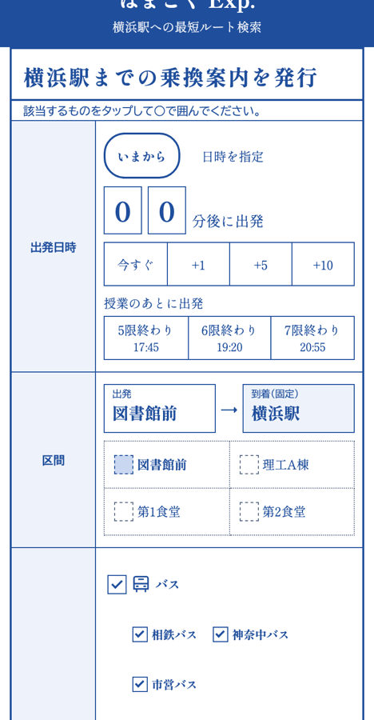
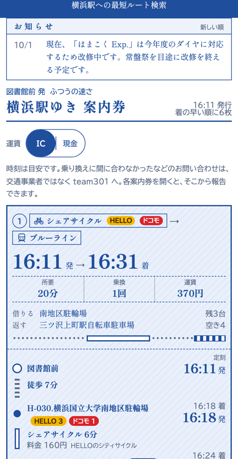
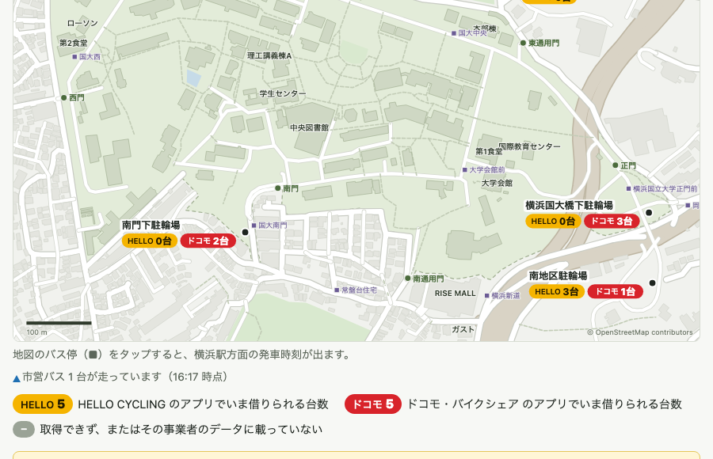
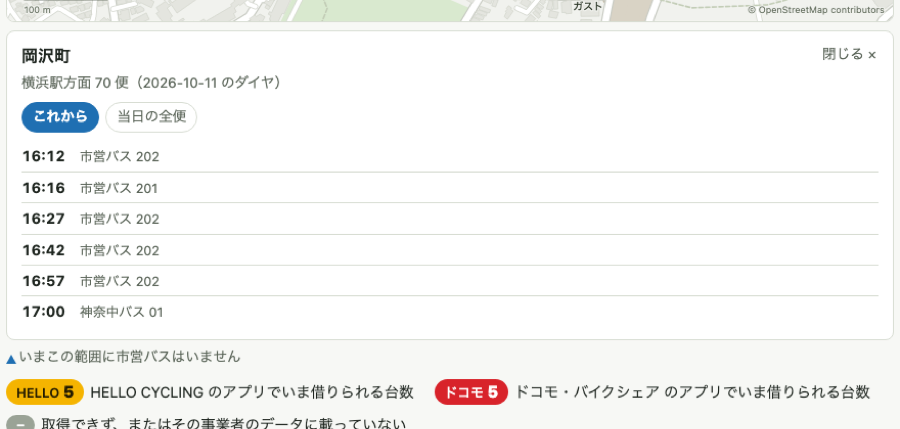

# アプリはまこく（はまこく Exp. / はまこく Map）

横浜国立大学（YNU）の構内から横浜駅へ向かう人のための、公共交通アプリです。公共交通オープンデータ（[ODPT](https://www.odpt.org/)）の交通データと、シェアサイクルの空き情報を使います。

| アプリ | 中身 |
|---|---|
| **はまこく Exp.** | 構内の各地点から横浜駅までの最速ルートを検索する。バス・電車・シェアサイクル・徒歩を組み合わせ、到着時刻の早い順に出す |
| **はまこく Map** | 構内と横浜駅まわりの地図。シェアサイクルの台数、走っているバス、バス停と駅の発車時刻が見られる |

実際に動いている様子は [https://team301.jp](https://team301.jp) で確認できます。

## なぜ作ったか


横浜国大の周辺には、公共交通で出かけにくい事情が重なっています。

- 大学周辺が**坂だらけ**
- 大学周辺に**お店がほとんどない**
- 大学最寄駅が複数あるが、**どの駅に向かうにしても遠い**
- キャンパスが大きいため、**建物によって最寄りの駅やバス停が異なる**

ゴルフ場だった土地に大学を移した経緯から、周囲への公共交通アクセスは歴史的に不便です。大学周辺に歓楽街もないため、夕食や懇親会などで集まろうとすると、横浜駅に出るしかありません。

そこで、公共交通オープンデータのリアルタイムな情報を使い、「いまの建物から、どの経路が一番早く横浜駅に着くか」をすぐ調べられるアプリにしました。

## はまこく Exp. でできること

- 構内の出発地（図書館前、第1食堂、第2食堂、理工学部A棟など）から、横浜駅への最速ルートを探せる
- 出発時刻の指定のほか、「いまから何分後に出る」でも検索できる
- 利用する交通手段（バス・電車・シェアサイクル・徒歩）や、使う交通事業者を絞れる
- 歩く速さ（ゆっくり〜ダッシュ）に合わせて、徒歩の時間が変わる
- 乗り換えが間に合う便だけを、運賃（IC／現金）つきで出す

スマホの画面（左: 検索前の申込書、右: 結果の案内券）

 

### 対応している交通機関（2026年10月時点）

- 鉄道
  - 横浜市営地下鉄（最寄: 三ツ沢上町駅）
  - 相鉄線（最寄: 和田町駅、上星川駅）
- バス
  - 横浜市営バス、相鉄バス、神奈中バス（最寄: 国大中央、岡沢町、横浜新道、ひじりヶ丘など）
- シェアサイクル（HELLO CYCLING、ドコモ・バイクシェア）
  - 大学周辺のポート: 5か所
  - 横浜駅周辺のポート: 9か所
  - 三ツ沢上町駅・和田町駅で鉄道に乗り換える場合にも対応
- 徒歩

### 注意

- 時刻や台数は目安です。**情報の正確性は保証しません。**

## はまこく Map でできること

構内と横浜駅まわりのシェアサイクルポート・バス停・走っているバスを、地図で見られます。登録もインストールも要りません。

- **シェアサイクルの台数**を、ポートごとに事業者別（HELLO CYCLING・ドコモ・バイクシェア）で出す。自分が使うアプリの台数だけが借りられるため、合算はしない。開いている間は1分ごとに自動で更新する
- **構内と横浜駅の2つのエリア**をタブで切り替える。横浜駅は自転車を返す側のエリアなので、台数の代わりに「返せる空き」を出す
- **バス停をタップ**すると、横浜駅方面の発車時刻（これから／当日の全便）が出る。横浜市営バスは遅れも出る
- **走っている横浜市営バス**を、進む向きの矢印で地図に出す。タップすると、次に止まるバス停と終点の到着見込みが出る
- はまこく Exp. のルート検索が返却先に使うポートに、印を付ける

 

地図は OpenStreetMap をもとに、建物・道路・門・バス停を取り出して、構内が分かりやすいように描き直しています。台数はフィードの値で、現地と食い違うことがあります。地図に出る車両位置は横浜市営バスだけです（相鉄バス・神奈中バスは車両位置を配信していません）。

## しくみ

```
画面（フォーム）
  → 検索の受け口（Express）
  → ルート検索（複数の経路パターンを並列に実行し、到着時刻順に並べて上位を返す）
  → 経路パターンごとの処理 → 外部データごとの adapter → ODPT API / ローカルの時刻表
```

- **経路パターンごとに1ファイル**（例: 徒歩 → シェアサイクル → 三ツ沢上町 → 地下鉄）。1つの経路が失敗しても、ほかの結果は返る
- **外部データごとに adapter を分け**、事業者ごとのデータの癖をそこに閉じ込める
- **深夜の時刻**（「25:30」のような24時超えの表記）を、単調に増える分として扱う
- シェアサイクルは、事業者ごとにフィードの更新間隔や台数の意味が違うため、貸せる台数・返せる空きを事業者ごとに分けて読む
- 運賃・停留所と駅の ID・事業者の設定は `config/` に集め、経路の処理に値を直接書かない

### 技術スタック

- Node.js（ES Modules）、Express 5、EJS（サーバーサイドレンダリング）
- 画面の一部は React 19（Vite でビルド）
- express-validator、helmet、dotenv

### ディレクトリ

| ディレクトリ | 中身 |
|---|---|
| `app_v1/` | はまこく Exp. 本体（ルート検索、画面、設定） |
| `hamakokumap/` | はまこく Map |
| `site/` | 免責事項・プライバシーポリシー・データの提供元のページ |
| `brand/` | はまこくのロゴとアイコン |

## 動かす

```bash
git clone https://github.com/team301-yokohama/AppHamakoku-public.git
cd AppHamakoku-public/app_v1
npm install
cp .env.example .env     # ODPT の API キーを入れる（下の注意を参照）
npm start                # → http://localhost:3000/ （はまこく Exp. に飛びます。はまこく Map は /hamakokumap/）
```

### 報告・お問い合わせの欄について

画面の「間に合わなかった」などの報告の欄は、公開用では**無効**にしてあります（送り先が無く、送ったつもりで届かないのを避けるため）。使うには、`app_v1/.env` に `REPORT_ENABLED=true` と、送り先の設定が要ります。送り先を設定しない場合、報告は手元の `app_v1/apidata/reports/` に保存されます。

送り先は **Google フォーム**です。サーバーが、利用者の代わりにフォームへ送ります（利用者に Google の画面は見せません）。どんなフォームでもよいわけではなく、次の条件があります。

- 送信先（`REPORT_FORM_ACTION`）は `https://docs.google.com/forms/d/e/<フォームのID>/formResponse` の形にする。フォームの公開 URL の末尾の `viewform` を `formResponse` に変える
- サーバーから**ログインなしで**送るため、フォームは「回答者にログインを要求する」をオフにし、ファイルのアップロード欄は使わない
- 欄の対応（`REPORT_FORM_ENTRIES`）を JSON で渡す。キーは `kind`（種類。必須）・`message`（本文）・`route`（経路の要約）・`conditions`（検索条件）・`page`（送った画面）で、値は各欄の `entry.<数字>`。フォームに無い項目は省略できる
  ```
  {"kind":"entry.1","message":"entry.2","route":"entry.3","conditions":"entry.4","page":"entry.5"}
  ```
  `entry.<数字>` は、フォームの「事前入力したリンクを取得」で調べられる
- 欄は**記述式（短文・段落）**にする。`kind` には「乗り換えに間に合わなかった」「便・時刻が実際と異なる」のような**選択肢の文字列**が送られるので、選択式にする場合は、文字を完全に一致させる
- フォーム側で「回答を受け付けない」にしても、アプリは送れたと思って「受け付けました」と出す。止めるときは、フォームではなく `REPORT_ENABLED=false` にして再起動する

### 仮データでの表示（トークンが無くても画面を見られます）

ODPT の API キーが無いとき、または実データの取得に失敗したときは、**仮データ**に切り替えて表示します。画面の上に「実データが取得できないため、仮データで表示しています。」という帯が出ます。

- 仮データは、時刻表の形を借りた**作り物**です。実際の時刻・運行・遅れ・台数ではありません。検索して案内券が出るところまで（市営バス・相鉄バス・神奈中バス・地下鉄・相鉄線・シェアサイクルを使うもの。遅れの表示を含む）を確かめられます。
- 設定は `app_v1/.env` の `DEMO_MODE` です。`fallback`（既定）は実データが取れないときだけ、`always` はいつも仮データ、`off` は使いません。
- 歩く速さの表（`app_v1/db/transit/walking/`）も、公開用では作り物の値です。実際の徒歩時間ではありません。
- はまこく Map も、実データが取れないときは、仮データで表示します（シェアサイクルの台数、構内を走るバス、バス停の発車時刻、横浜駅から出る電車）。画面の上に、同じ帯が出ます。

### データについて

- 相鉄線と神奈中バスの時刻表は、配信元の規約により再配布できません。そのため、このリポジトリには**時刻表などの取得データを含めていません**。これらを使うルートは、手元ではデータを用意しないと動きません。
- ODPT の API キーは、[公共交通オープンデータセンター](https://www.odpt.org/)の開発者向けサイトから取得できます。
- キーが無くても起動します。取れない機能は画面から畳まれます。

## 開発メンバー (Contributors)

- @yagis0 - [全体的にチェックする人|コードとか書く人]

- @pero1031 - [コードとか書く人]

- @rissu1 - [コードとか書く人]

- @naritatower0721-hub - [名付け親]

- kakeru - [データ入力などの補助]

- Olabのメンバー - [技術的なアドバイスなど]

- てっけんのメンバー - [利用者目線でのアドバイスなど]

---

利用・転載などをしたい場合は、team301.official@gmail.com までご連絡ください。

© 2026 team301
